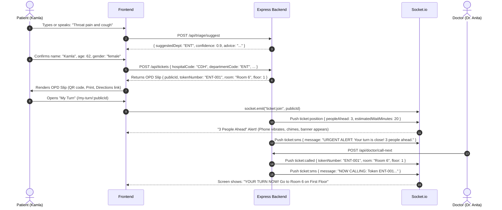
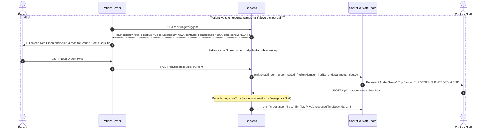

# Frontend Integration Guide & Backend State (Queue Mitra)

> **To my teammate**: This document details the **complete, fully implemented backend state** and provides the architectural diagrams, API contracts, Socket.io events, and UI screens needed to build out the frontend to score maximum marks across all 8 judging criteria.

---

## 1. System Architecture Diagram

```mermaid
flowchart TB
    subgraph Frontend["Frontend Client (React 18 + PWA)"]
        UI_Home["Home Screen ('/')\n• Symptom input (Voice/Text)\n• Emergency Guidance\n• Path selection"]
        UI_Register["Register Screen ('/register')\n• 1 Question / Screen\n• Picture cards for 7 depts\n• Assisted mode toggle"]
        UI_Slip["OPD Slip Screen ('/slip/:id')\n• Token (e.g. MED-042)\n• QR code + Room + Floor\n• Save/Print/Read aloud"]
        UI_Queue["My Turn Screen ('/my-turn/:id')\n• Live position countdown\n• '3 Ahead' Alert (sound/vibrate)\n• Simulated SMS Notification Drawer\n• 'I Need Urgent Help' button"]
        UI_Nav["Navigation Screen ('/map')\n• SVG Floor Plan (Floors 0, 1, 2)\n• Dijkstra route overlay\n• 'Avoid Stairs' switch\n• Checkpoint QR scanning\n• 'I'm Lost' staff card"]
        UI_Doctor["Doctor/Staff Portal ('/doctor')\n• Staff PIN ('1234') / Password\n• Call Next (atomic)\n• Requeue & Transfer\n• Overcrowding Heatmap\n• Urgent alert audio siren banner"]
        UI_Board["Waiting-Room TV Board ('/board')\n• Fullscreen TV display\n• Room-by-room tokens\n• Spoken TTS announcements"]
        UI_Analytics["Admin Analytics ('/analytics')\n• Patient flow & hourly traffic\n• Emergency response SLA\n• Overcrowding status"]
    end

    subgraph BackendAPI["Backend Express 5 Server (Port 5000)"]
        RT_Triage["/api/triage/*\n• Red-flag warning check\n• Safe department suggestion"]
        RT_Tickets["/api/tickets/*\n• Registration & Counter\n• Printable Slip generation\n• Preferences & Urgent flag\n• Offline PWA sync"]
        RT_Nav["/api/navigation/*\n• Dijkstra shortest path\n• Avoid stairs filter\n• QR Checkpoint routing\n• Nearest help desk (Lost)"]
        RT_Doctor["/api/doctor/*\n• Call next\n• Requeue to tail\n• Move department\n• Mark seen urgent (SLA)"]
        RT_Board["/api/board/*\n• Aggregated hospital feed\n• Bilingual speech strings"]
        RT_Sms["/api/notifications/*\n• Simulated SMS inbox\n• Automated event triggers"]
        RT_Analytics["/api/analytics/*\n• Overcrowding metrics\n• SLA compliance"]
        RT_Demo["/api/demo/*\n• 10x auto-simulation runner\n• Seed 20 demo patients\n• Reset queues"]
        RT_Auth["/api/auth/*\n• Doctor login/logout\n• Staff PIN login ('1234')"]
    end

    subgraph RealTime["Real-Time Layer (Socket.io)"]
        WS_Rooms["Rooms:\n• ticket:publicId\n• department:deptId\n• staff:hospitalId\n• board:hospitalId"]
    end

    subgraph DataLayer["Database & Spatial Graph"]
        DB_Mongo[(MongoDB)\nHospitals, Departments,\nUsers, Tickets, Counters,\nNotifications]
        Graph_Map[(Spatial Graph)\n28 Places, 3 Floors,\nLandmarks in EN/HI/TA,\n7 Wall QR Checkpoints]
    end

    %% Client to API links
    UI_Home -->|POST /api/triage/suggest| RT_Triage
    UI_Register -->|POST /api/tickets| RT_Tickets
    UI_Register -->|GET /api/hospitals/CDH/departments| RT_Tickets
    UI_Slip -->|GET /api/tickets/:publicId/slip| RT_Tickets
    UI_Queue -->|GET /api/tickets/:publicId| RT_Tickets
    UI_Queue -->|PATCH /api/tickets/:publicId/preferences| RT_Tickets
    UI_Queue -->|POST /api/tickets/:publicId/urgent| RT_Tickets
    UI_Queue -->|GET /api/notifications/:publicId| RT_Sms
    UI_Nav -->|POST /api/navigation/route| RT_Nav
    UI_Nav -->|POST /api/navigation/from-checkpoint| RT_Nav
    UI_Nav -->|POST /api/navigation/lost| RT_Nav
    UI_Doctor -->|REST actions| RT_Doctor
    UI_Doctor -->|POST /api/auth/staff-pin| RT_Auth
    UI_Board -->|GET /api/board/CDH| RT_Board
    UI_Analytics -->|GET /api/analytics/CDH| RT_Analytics

    %% WebSockets
    UI_Queue <==>|ticket:position, ticket:called, ticket:sms| WS_Rooms
    UI_Doctor <==>|urgent:raised, queue:updated| WS_Rooms
    UI_Board <==>|token:called, queue:updated| WS_Rooms

    %% Backend to Data
    BackendAPI --> DB_Mongo
    RT_Nav --> Graph_Map
    BackendAPI <--> RealTime
```

---

## 2. Core User Flows

### Flow A: Patient Registration & Live Turn Sequence



---

### Flow B: Hospital Navigation with Dijkstra, "Avoid Stairs" & QR Checkpoints

```mermaid
sequenceDiagram
    autonumber
    actor Patient as Patient
    participant UI as Navigation UI
    participant Nav as Navigation Engine (Backend)

    alt Patient starts from Main Entrance
        Patient->>UI: Clicks "Guide me to Room 6" (Toggles: [x] Avoid Stairs)
        UI->>Nav: POST /api/navigation/route { from: "main_entrance_0", to: "room_6", avoidStairs: true }
    else Patient scans a QR poster inside hospital (e.g. at Elevator)
        Patient->>UI: Scans QR code on wall
        UI->>Nav: POST /api/navigation/from-checkpoint { checkpointId: "CP_LIFT_G", to: "room_6", avoidStairs: true }
    end

    Note over Nav: Removes all stair edges from graph.<br/>Runs Dijkstra shortest path via Lifts/Ramps.
    Nav-->>UI: Route nodes, distance (48m), walk time (2 mins), landmark steps:
    Note over UI: Step 1: Elevator Lobby (Floor 0)<br/>Step 2: Take lift up to First Floor<br/>Step 3: Exit into Waiting Hall A<br/>Step 4: Turn right down corridor; Room 6 is opposite water cooler.
    UI->>Patient: Visual route on SVG map + Audio narration ("Listen")
```

---

### Flow C: Emergency Warning or "I Need Urgent Help" (SLA Audited)



---

## 3. Frontend Screen Roadmap

Here are the core screens recommended for the hackathon prototype:

| Screen | Route | Description & Key Elements |
|---|---|---|
| **1. Home** | `/` | 4 big buttons (Register, My Slip, Find a Place, Emergency), Voice input box, Language Switcher (EN, HI, TA). |
| **2. Registration** | `/register` | 1 question per screen with progress bar: Name, Age, Gender, Mobile, Department Cards (7 depts with picture/plain words), "Assisted Mode" toggle (larger text, reads aloud). |
| **3. OPD Slip** | `/slip/:publicId` | Calls `GET /api/tickets/:id/slip`. Displays Token badge, Doctor, Room, Floor, Estimated Wait, QR Code. Action buttons: "Save Image", "Print", "Read Aloud", "Directions to Room". |
| **4. My Turn** | `/my-turn/:publicId` | Live queue position countdown (`ticket:position`), "3 ahead" alert (vibration + sound), Simulated SMS Notification drawer (`ticket:sms`), doctor delay banner, "I need urgent help" button, and "Called" state with room directions. |
| **5. Navigation** | `/map` | Inline SVG floor plan for Floors 0, 1, 2. "Avoid Stairs" switch (routes via lifts), QR Checkpoint scanner (`POST /api/navigation/from-checkpoint`), step-by-step landmark directions, "Listen" audio button, and **"I'm Lost"** button (generates bilingual card to show staff). |
| **6. Doctor / Staff Portal** | `/doctor` | Login with Staff PIN (`1234`) or Doctor email. Department queue list, Call Next button, Mark No-Show, Requeue to End, Move Department, Doctor Status toggle (Available / On Break / Running Late), Urgent Alert popup banner with audio ping. |
| **7. TV Waiting-Room Board** | `/board` | High-contrast TV view (`/board/CDH`). Cycles through rooms, active token, next 3 tokens, doctor delays, and spoken audio announcements via Web Speech API. |
| **8. Hospital Analytics** | `/analytics` | Admin dashboard showing patient throughput, live overcrowding heatmap (`green`/`amber`/`red`), hourly traffic curve, and emergency response SLA compliance. |

---

## 4. API Endpoints Contract Cheat Sheet

All endpoints are hosted at `http://localhost:5000/api` (or proxied via Vite `/api`).

### A. Patient Registration & Queue

#### `POST /api/tickets`
Creates ticket and enters queue.
```json
// Request
{
  "hospitalCode": "CDH",
  "departmentCode": "MED",
  "firstName": "Kamla",
  "age": 62,
  "gender": "female",
  "mobile": "9876543210",
  "language": "hi",
  "isAssisted": true,
  "accessibility": {
    "avoidStairs": true,
    "largeText": true,
    "readAloud": true
  }
}
```

#### `POST /api/tickets/counter`
Fast walk-in registration by staff (for patients without phones):
```json
// Request
{ "departmentCode": "MED", "firstName": "Ramesh", "age": 70, "gender": "male" }
// Returns full printable slip immediately
```

#### `GET /api/tickets/:publicId/slip`
Returns full printable/downloadable OPD slip data with hospital details, QR payload, room, floor, and bilingual disclaimers.

#### `PATCH /api/tickets/:publicId/preferences`
Updates accessibility or language preferences:
```json
// Request
{
  "language": "hi",
  "accessibility": { "avoidStairs": true, "largeText": true }
}
```

#### `GET /api/tickets/lookup/:tokenNumber?hospitalCode=CDH`
Look up ticket when a patient enters their printed token number (e.g. `/api/tickets/lookup/MED-001`).

#### `POST /api/tickets/:publicId/urgent`
Triggers an immediate emergency flag to all doctors/staff in the hospital.

---

### B. Navigation & Dijkstra Routing

#### `POST /api/navigation/route`
Calculates Dijkstra shortest path.
```json
// Request
{
  "from": "main_entrance_0",
  "to": "room_3",
  "avoidStairs": true,
  "language": "hi"
}
```

#### `GET /api/navigation/checkpoints`
Returns all physical wall poster QR checkpoints.

#### `POST /api/navigation/from-checkpoint`
Routes directly from a scanned wall poster:
```json
// Request
{
  "checkpointId": "CP_LIFT_G",
  "room": "Room 6",
  "avoidStairs": true,
  "language": "hi"
}
```

#### `POST /api/navigation/lost`
Finds nearest Help Desk and generates the "Show to Staff" card.
```json
// Request
{ "currentFloor": 1, "destinationPlaceId": "room_3", "language": "hi" }
```

---

### C. Simulated SMS Notifications

#### `GET /api/notifications/:publicIdOrMobile`
Retrieves all simulated SMS messages for that ticket or phone number so the UI can show an incoming notification drawer!

---

### D. Staff Analytics & Overcrowding Heatmap

#### `GET /api/analytics/CDH`
Returns real-time totals, waiting/completed counts, department overcrowding heatmap (`green`, `amber`, `red`), hourly traffic curve, and emergency response SLA statistics.

---

### E. TV Waiting-Room Board

#### `GET /api/board/CDH`
Returns all active rooms, current tokens called, next 3 tokens, doctor delays, and spoken speech announcement strings ready for audio playback.

---

### F. Staff & Doctor Actions

#### `POST /api/auth/staff-pin`
```json
// Request
{ "hospitalCode": "CDH", "pin": "1234" }
```

#### Doctor Controls (Header: `Authorization: Bearer <token>` or Cookie)
- `GET /api/doctor/dashboard`: Queue snapshot, current patient, waiting list.
- `POST /api/doctor/call-next`: Atomically calls the next waiting patient.
- `POST /api/doctor/tickets/:id/requeue`: Sends patient to the end of the line.
- `POST /api/doctor/tickets/:id/transfer`: Moves patient to another department `{ departmentCode: "ORT" }`.
- `PATCH /api/doctor/status`: `{ state: "on_break", until }` or `{ state: "running_late", delayMinutes: 15 }`.
- `GET /api/doctor/urgent`: Lists active urgent flags.
- `POST /api/doctor/urgent/:id/seen`: Dismisses an urgent flag and records SLA.

---

### G. 10x Live Auto-Simulation Controls

- `POST /api/demo/auto-simulate/start`: Starts auto-progression of queues every few seconds for live presentation demos: `{ intervalMs: 3000 }`.
- `POST /api/demo/auto-simulate/stop`: Stops the simulation.
- `POST /api/demo/seed-patients`: Generates 20 sample patients across all 7 departments.
- `POST /api/demo/reset`: Flushes all queues and resets counters back to clean state.

---

## 5. Socket.io Integration in Frontend

```javascript
import { io } from "socket.io-client";

export const socket = io("http://localhost:5000", { withCredentials: true });

// In Patient "My Turn" Screen:
socket.emit("ticket:join", publicId);
socket.on("ticket:position", (data) => {
  // data: { peopleAhead, estimatedWaitMinutes, nowServing }
  if (data.peopleAhead === 3) {
    playNotificationSound();
    if (navigator.vibrate) navigator.vibrate([200, 100, 200]);
  }
});
socket.on("ticket:sms", (sms) => {
  // Displays the incoming simulated SMS notification drawer!
  showSmsNotification(sms.message);
});
socket.on("ticket:called", (call) => {
  // call: { room, floor, doctorName }
  showCalledBanner(call);
});

// In TV Waiting Room Board:
socket.emit("board:join", hospitalId);
socket.on("token:called", (data) => {
  // Read announcement aloud using window.speechSynthesis
});

// In Doctor / Staff Screen:
socket.on("urgent:raised", (alert) => {
  playUrgentSiren();
  showPersistentUrgentBanner(alert);
});
socket.on("urgent:seen", ({ seenBy, responseTimeSeconds }) => {
  dismissUrgentBanner();
});
```

---

## 6. How to Run Locally

1. **Terminal 1: Start Backend**
   ```bash
   cd backend
   cp .env.example .env    # ensure MONGODB_URI is set
   npm install
   npm run seed            # seeds CDH hospital, 7 departments, 8 doctors
   npm run dev             # runs on http://localhost:5000
   ```

2. **Terminal 2: Start Frontend**
   ```bash
   cd frontend
   npm install
   npm run dev             # runs on http://localhost:5173
   ```
